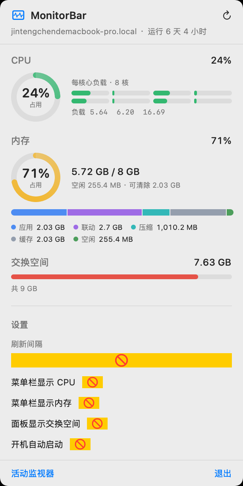

# MonitorBar

A lightweight macOS menu bar widget that shows real-time CPU and memory usage, built with SwiftUI and native Mach APIs.



## 功能

- **菜单栏实时数字**：`[cpu] 12%   [mem] 5.7 GB`，使用 SF Symbol 图标（亮色模式黑、暗色模式白），0.5s 刷新
- **下拉面板**：
  - CPU 环形仪表 + 8 核每核心横向负载条 + 1/5/15 分钟负载
  - 温度段：拿到 entitlement 时显示 SMC 真温度（°C + 刻度条 + 60/80°C 阈值），拿不到时降级为 4 档热状态（`NSProcessInfo.thermalState`）显示 nominal/fair/serious/critical
  - 内存环形仪表 + 已用/总量 + 应用/联动/压缩/缓存/空闲堆叠条 + 图例
  - 交换空间（可选）
  - 主机名、运行时间
- **设置项**：刷新间隔（0.5/1/2/5s）、菜单栏显示项、面板显示交换空间、开机自动启动
- **点外面自动关**：macOS 状态栏 popover 的 transient 在菜单栏 app 上经常失效，挂了 NSWorkspace 激活通知 + 全局鼠标监听 + 350ms 打开宽限期三层兜底
- **命令行自检**：`MonitorBar --sample` 打印 3 帧真实采样和原始 tick，跟 `top` 对照

## 兼容性

### 系统要求

| 项目 | 要求 |
| --- | --- |
| macOS | **14.0 Sonoma 或更高**（LSMinimumSystemVersion = 14.0） |
| CPU | Apple Silicon (M1/M2/M3/M4) 或 Intel x86_64 |
| Swift | 5.10+（随 Xcode 15.3+ 或独立 toolchain） |
| SDK | macOS 14+（使用了 `MenuBarExtra` 之前的 NSStatusItem API 之外，没有 14 以下不可用的 API） |

### 架构

Mach API 全部走的是跨架构的 `host_statistics` / `host_statistics64` / `host_processor_info` / `sysctlbyname`，**没有架构特定代码**，同一份源码在 Apple Silicon 和 Intel 上都跑。

### 依赖

- 零第三方依赖（纯系统框架 `AppKit` / `SwiftUI` / `ServiceManagement`）
- 用到的系统能力：
  - **Mach host statistics**（CPU 累计 tick、内存 vm_statistics64、交换空间 xsw_usage）— 所有 macOS
  - **`sysctlbyname("hw.memsize" / "vm.loadavg" / "vm.swapusage")`** — 所有 macOS
  - **`SMAppService.mainApp`**（开机启动）— macOS 13+
  - **`NSStatusBar.system.statusItem`** + **`NSPopover`** — 所有 macOS
  - **`NSEvent.addGlobalMonitorForEvents`**（点击外部关闭）— 需要 *系统设置 → 隐私与安全性 → 辅助功能* 授权，**未授权也能用**，只是少一层兜底
  - **`@Observable` 宏** — Swift 5.9+ / macOS 14+
  - **`AppleSMC` (IOKit)** — 读 CPU 温度。**macOS 15+ 需要 `com.apple.developer.temperature-monitoring` 私有 entitlement**（需 Apple Developer Program 成员 + 特殊 provisioning profile）。本仓库已在 `Resources/MonitorBar.entitlements` 声明，但 ad-hoc 签名拿不到真正的授权。**读不到时面板自动降级为 4 档热状态（`NSProcessInfo.thermalState`），不会报错**

## 构建 & 运行

```bash
git clone https://github.com/Chenjinteng/macos_monitorbar.git
cd macos_monitorbar

# Release 构建 + 打包 .app + 启动
./build-app.sh --run

# Release 构建 + 安装到 /Applications
./build-app.sh --install

# Debug 构建
./build-app.sh --debug

# 命令行自检（不开 GUI，3 帧采样）
swift run MonitorBar --sample
```

`build-app.sh` 会做：
1. `swift build -c release`
2. 把二进制、Info.plist、图标装到 `build/MonitorBar.app/`
3. 用 `Tools/make-icon.swift` 生成 10 张 PNG → `iconutil` 转成 `.icns`
4. ad-hoc 签名（`codesign --sign -`）
5. 启动后 `killall Dock` 刷新图标缓存

## 命令行参数

| 参数 | 说明 |
| --- | --- |
| `--sample` | 打印 3 帧真实采样值（含原始 tick 增量），用于跟 `top` 对照 |
| `--render-preview <path>` | 离屏渲染面板到 PNG（调试用，不依赖屏幕录制权限） |

## 自定义

- **修改 Bundle ID**：`Resources/Info.plist` 里的 `CFBundleIdentifier`，默认是占位符 `com.example.monitorbar`，上线前改成你自己的（例如 `com.github.<你的用户名>.monitorbar`）。
- **修改图标**：编辑 `Tools/make-icon.swift` 的 `makeImage(pixels:)` 重新画，然后 `build-app.sh` 重新跑。
- **采样频率**：面板的"刷新间隔" 4 档（0.5/1/2/5 秒），重启 App 后生效。

## 项目结构

```
.
├── Package.swift                # SwiftPM 工程定义
├── Resources/
│   ├── Info.plist               # App Bundle 元信息
│   └── screenshot-panel.png     # README 截图
├── Sources/MonitorBar/
│   ├── App.swift                # @main + AppDelegate + 菜单栏 title 装配
│   ├── SystemSampler.swift      # Mach API 采样（CPU/内存/交换空间/负载）
│   ├── SMCSampler.swift         # IOKit SMC 读 CPU 温度（macOS 15+ 受 entitlement 限制）
│   ├── SystemMonitorModel.swift # @Observable 状态 + 偏好 + 定时器
│   ├── MenuBarPanel.swift       # SwiftUI 下拉面板
│   ├── Models.swift             # SystemSnapshot / MemorySample 数据结构
│   ├── Theme.swift              # 配色 / 格式化 / 环形仪表 / 分项条 / 热状态条
│   └── PreviewRenderer.swift    # 离屏渲染（调试）
├── Tools/
│   └── make-icon.swift          # App 图标生成器
└── build-app.sh                 # 打包脚本
```

## 调试踩坑笔记

工程里采样的 Mach API 在 Swift 里有几个坑，注释里都写了：

- `cpu_tick_info` 在 Swift 里被导入成 **4 元组**，不是带命名字段的 struct，必须用 `.0/.1/.2/.3`
- `xsw_usage` 在新 SDK 里字段改名 `xsu_total / xsu_used`，旧名 `xsw_*` 不存在
- 压缩内存必须用 `compressor_page_count`（实际占用的物理页），**不要**用 `total_uncompressed_pages_in_compressor`（解压后的原始体积，机器低内存时会算出 17 GB）
- CPU 两次 tick 求差时 `UInt64` 回绕要把 `old/new` 参数顺序显式命名成 `from:to:`，否则回绕后的值会被 `min/max` clamp 成 0
- `MenuBarExtra` 的 label 里嵌套 `HStack` 会被 NSStatusItem 丢掉子项，**稳的写法是直接用 `NSStatusBar.system.statusItem` + `NSAttributedString` + `NSTextAttachment`**
- 菜单栏 popover 用 `NSEvent.addGlobalMonitorForEvents` 兜底关窗时，**必须给 350ms 宽限期**，否则同一次"打开点击"会被自己接住、瞬间又关掉

## License

MIT
